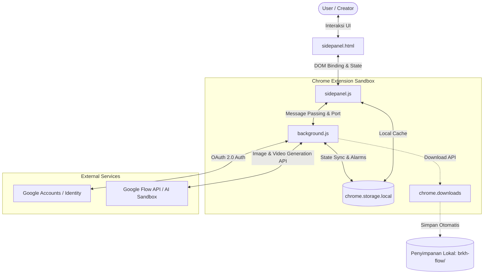

# Arsitektur & Fitur — BRKH Turbo Flow Pro

Dokumen ini menjelaskan arsitektur sistem, struktur berkas, aliran data, dan fitur-fitur yang tersedia di dalam ekstensi Chrome **BRKH Turbo Flow Pro**. Ekstensi ini dikembangkan khusus sebagai alat bantu internal (internal workflow) BRKH Studio untuk melakukan generasi gambar dan video AI secara massal (bulk generation).

---

## 1. Ikhtisar Arsitektur (Architecture Overview)

BRKH Turbo Flow Pro dibangun menggunakan standar **Chrome Extension Manifest V3** dengan arsitektur decoupled (terpisah) antara antarmuka pengguna (UI) dan logika background processing.

### Diagram Arsitektur


### Komponen Utama:
1. **Antarmuka (Side Panel UI)**:
   - [sidepanel.html](file:///d:/AI%20PROJECT/brkh%20turbo%20flow/sidepanel.html): Menyediakan struktur antarmuka utama yang dimuat di panel samping Google Chrome.
   - [sidepanel.js](file:///d:/AI%20PROJECT/brkh%20turbo%20flow/sidepanel.js): Mengontrol perulangan antarmuka, input pengguna, perpindahan tab, dan validasi form lokal.
   - [style.css](file:///d:/AI%20PROJECT/brkh%20turbo%20flow/style.css): Menyusun gaya visual dengan tema kustom *Midnight Blue* dan aksen *Cyan*.
2. **Latar Belakang (Background Service Worker)**:
   - [background.js](file:///d:/AI%20PROJECT/brkh%20turbo%20flow/background.js): Berjalan sebagai *Service Worker* yang menangani pemanggilan API asinkron, manajemen antrean (queue), download file, dan pemulihan sesi (session recovery) saat panel samping ditutup dan dibuka kembali.
3. **Penyimpanan Lokal (State Management)**:
   - `chrome.storage.local`: Digunakan untuk menyimpan daftar antrean, cache galeri, status library, setelan pengguna, dan token otentikasi palsu (bypass pro).
4. **Alur Build Kustom**:
   - [build.js](file:///d:/AI%20PROJECT/brkh%20turbo%20flow/build.js): Naskah build NodeJS untuk mengubah kode referensi dasar (mentah) dari folder `reference/` menjadi berkas ekstensi siap pakai di direktori utama dengan melakukan branding ulang, bypass verifikasi server, dan aktivasi fitur Pro secara permanen.

---

## 2. Struktur Berkas Proyek

Berikut adalah berkas-berkas utama beserta fungsinya di workspace ekstensi:

* [manifest.json](file:///d:/AI%20PROJECT/brkh%20turbo%20flow/manifest.json) — Konfigurasi manifest ekstensi (Manifest V3) yang mendefinisikan izin (permissions), background script, dan default path untuk panel samping.
* [background.js](file:///d:/AI%20PROJECT/brkh%20turbo%20flow/background.js) — Logika inti background worker (antrean, integrasi API AI, downloader).
* [sidepanel.html](file:///d:/AI%20PROJECT/brkh%20turbo%20flow/sidepanel.html) — Layout UI yang memuat 5 tab utama dan modal disclaimer.
* [sidepanel.js](file:///d:/AI%20PROJECT/brkh%20turbo%20flow/sidepanel.js) — Logika interaksi UI, visualisasi antrean, serta tour panduan.
* [style.css](file:///d:/AI%20PROJECT/brkh%20turbo%20flow/style.css) — Tema warna gelap (*Midnight Blue*) dan pengaturan layout responsif.
* [build.js](file:///d:/AI%20PROJECT/brkh%20turbo%20flow/build.js) — Alat otomasi kompilasi yang menyatukan aset referensi ke berkas rilis ekstensi.
* [restore_ui.js](file:///d:/AI%20PROJECT/brkh%20turbo%20flow/restore_ui.js) — Script pembantu untuk menambal rasio gambar 1:1 dan logo BRKH Studio di berkas HTML.

---

## 3. Fitur Utama Ekstensi

Ekstensi **BRKH Turbo Flow Pro** dikemas dengan fungsionalitas tingkat lanjut untuk optimasi alur kerja kreatif:

### A. Generator Gambar Massal (Batch Image Generation)
Mendukung pembuatan gambar secara massal dari daftar perintah (prompts) teks.
* **Model AI**: Terintegrasi dengan model **Nano Banana Pro**, **Nano Banana 2**, dan **Imagen 4**.
* **Jumlah Variasi**: Memungkinkan pembuatan 1 hingga 4 variasi gambar per baris prompt secara bersamaan.
* **Aspek Rasio (Aspect Ratio)**:
  - **Landscape (L)**: Rasio mendatar (seperti 16:9).
  - **Portrait (P)**: Rasio tegak (seperti 9:16).
  - **Square (1:1)**: Rasio kotak seimbang (ditambahkan secara khusus melalui penambal UI).

### B. Generator Video Massal (Batch Video Generation)
Mendukung pembuatan video pendek asinkron secara beruntun.
* **Model AI**: Menggunakan teknologi **Veo 3.1** yang bertenaga.
* **Mode Kualitas Video**:
  - **Lite Mode**: Proses cepat untuk pratinjau instan.
  - **Fast Mode**: Kecepatan seimbang untuk draf video yang bagus.
  - **Quality Mode**: Hasil detail terbaik untuk rilis final.
* **Mode Masukan Video**:
  - **Text to Video**: Generasi murni dari deskripsi teks.
  - **Start Frame (Image to Video)**: Menggunakan gambar dari pustaka (Library) sebagai bingkai awal video.
  - **Start & End Frame**: Menggunakan gambar awal dan gambar akhir untuk mengontrol transisi video.
  - **Reference Video**: Menggunakan gaya atau gerakan dari video referensi.

### C. Manajemen Antrean & Kontrol Kecepatan (Queue & Speed System)
Sistem penjadwalan cerdas untuk memproses tugas pembuatan media tanpa memicu blokir batas kecepatan (Rate Limit) Google API.
* **Speed Modes (Pacing)**:
  - **Fast**: Menjalankan maksimal 3 tugas secara paralel dengan jeda antar-tugas 100ms.
  - **Balanced**: Menjalankan maksimal 2 tugas secara paralel dengan jeda antar-tugas 2.0 detik.
  - **Slow**: Menjalankan 1 tugas saja dengan jeda aman 3.0 detik.
* **Fitur Kontrol**: Tombol *Pause*, *Resume*, dan *Clear* untuk mengontrol tugas yang sedang berjalan secara dinamis.
* **Ekspor/Impor**: Pengguna dapat mengunduh daftar antrean dalam format berkas `.json` dan mengimpornya kembali untuk melanjutkan sesi kerja di lain waktu.

### D. Pustaka Gambar & Pemetaan Referensi (Library & Reference Mapper)
Memungkinkan manajemen file gambar referensi yang fleksibel untuk memandu gaya visual AI.
* **Library Management**: Unggah gambar lokal, simpan ke memori ekstensi, dan tandai dengan label pencarian (`@tag`).
* **Reference Mapper Mode**:
  - **1:1 Mapping**: Memetakan baris prompt secara berurutan dengan gambar di pustaka.
  - **Same-for-All**: Menggunakan satu gambar referensi yang sama untuk seluruh daftar prompt dalam antrean.
  - **Auto-Tag Matching**: Memasangkan gambar referensi dengan prompt secara otomatis berdasarkan kecocokan label/tag yang ditulis pengguna (contoh: menulis `@anime` di prompt akan memanggil gambar yang ditandai tag `@anime`).

### E. Pengunduh Otomatis & Penamaan Berkas (Auto-Downloader)
* **Pengunduhan Paralel**: Semua berkas hasil generasi langsung diunduh ke folder penyimpanan komputer pengguna (default: `Downloads/brkh-flow/`).
* **Pilihan Resolusi Download**:
  - Gambar: Pilihan Standard, 2K, dan 4K.
  - Video: Pilihan 720p, 1080p, dan 4K.
* **Format Penamaan Dinamis (Naming Format)**:
  - Nomor urut generator (contoh: `0001`, `0002`).
  - Potongan teks dari prompt masukan.
  - Prefix nama kustom dengan pilihan pemisah berupa spasi (` `), tanda hubung (`-`), atau garis bawah (`_`).

### F. Antarmuka 5 Tab Utama (The 5-Tab UI Layout)
Aplikasi terbagi menjadi lima bagian navigasi yang rapi di panel samping:
1. **Control**: Panel parameter untuk mengonfigurasi model, gaya, aspek rasio, folder download, dan penginputan teks perintah (prompts).
2. **Queue**: Daftar pengerjaan aktif yang memperlihatkan progres persentase, status sukses/gagal, dan opsi kontrol antrean.
3. **Gallery**: Papan pratinjau hasil generasi dengan opsi klik untuk memperbesar (preview modal), tombol unduh manual per berkas, opsi pilih semua (select all), dan tombol hapus galeri.
4. **Library**: Tempat mengunggah, melihat, dan memberi tag pada gambar-gambar referensi lokal.
5. **Logs**: Riwayat log sistem real-time untuk mendeteksi kesalahan teknis, pelacakan proses API, serta peringatan batas kuota (quota limit warnings).

### G. Bypass Autentikasi & Proteksi Keamanan Internal
* **Bypass Pro Permanen**: Sistem pembayaran LemonSqueezy dan pelacakan event Vercel dinonaktifkan sepenuhnya di [build.js](file:///d:/AI%20PROJECT/brkh%20turbo%20flow/build.js). Ekstensi langsung diatur ke status **Pro Tier** (`PAYGATE_TIER_TWO`) saat diaktifkan tanpa membutuhkan verifikasi server eksternal.
* **Modal Disclaimer Internal Studio**: Setiap kali ekstensi dibuka, sebuah jendela pop-up peringatan berwarna Midnight Blue akan muncul terlebih dahulu. Pengguna diharuskan menyetujui pernyataan bahwa ekstensi ini adalah **properti internal BRKH Studio** yang dilarang keras untuk didistribusikan atau disebarkan source code-nya tanpa izin tertulis dari developer (Copyright © 2026 BRKH Studio).

---

## 4. Analisis Izin Manifest (Permissions & Hosts)

Ekstensi meminta beberapa hak akses sensitif di [manifest.json](file:///d:/AI%20PROJECT/brkh%20turbo%20flow/manifest.json) untuk mendukung fungsionalitas asinkronnya:

| Izin (Permission) | Kegunaan Utama |
| :--- | :--- |
| `storage` | Menyimpan preferensi, antrean tertunda, riwayat galeri, dan session state. |
| `downloads` | Mengunduh hasil gambar/video secara otomatis ke penyimpanan lokal pengguna serta melakukan kustomisasi penamaan file. |
| `sidePanel` | Membuka dan menyematkan antarmuka ekstensi di panel samping Chrome untuk mempermudah multi-tasking. |
| `alarms` | Menjaga agar Background Service Worker tetap aktif (tidak tertidur) selama proses generasi batch yang panjang. |
| `identity` | Penanganan token masuk Google secara opsional jika diperlukan. |
| `tabs` & `scripting` | Memantau aktivitas tab rujukan Google AI Sandbox untuk pertukaran cookie dan validasi otentikasi. |

**Host Permissions (Akses Jaringan)**:
* `https://labs.google/*` & `https://aisandbox-pa.googleapis.com/*`: Digunakan untuk mengirimkan permintaan generasi media langsung ke API resmi Google Flow.
* `https://www.googleapis.com/*` & `https://accounts.google.com/*`: Digunakan untuk melakukan pertukaran kredensial login akun Google secara aman.

---

## 5. Prosedur Melakukan Build Ulang (Re-build)

Jika terdapat perubahan pada berkas sumber di dalam folder `reference/`, pengembang internal BRKH Studio dapat memicu kompilasi ulang dengan langkah berikut:

1. Pastikan NodeJS sudah terinstal di komputer.
2. Buka terminal (PowerShell / Command Prompt) pada direktori kerja proyek `d:\AI PROJECT\brkh turbo flow`.
3. Jalankan perintah:
   ```bash
   node build.js
   ```
4. Jika diperlukan, jalankan script penambal UI tambahan:
   ```bash
   node restore_ui.js
   ```
5. Hasil kompilasi berupa file [background.js](file:///d:/AI%20PROJECT/brkh%20turbo%20flow/background.js), [sidepanel.html](file:///d:/AI%20PROJECT/brkh%20turbo%20flow/sidepanel.html), [sidepanel.js](file:///d:/AI%20PROJECT/brkh%20turbo%20flow/sidepanel.js), dan [style.css](file:///d:/AI%20PROJECT/brkh%20turbo%20flow/style.css) akan diperbarui secara otomatis di direktori utama dan siap untuk dimuat kembali (Reload) ke peramban Google Chrome melalui menu `chrome://extensions/` (*Load unpacked*).
